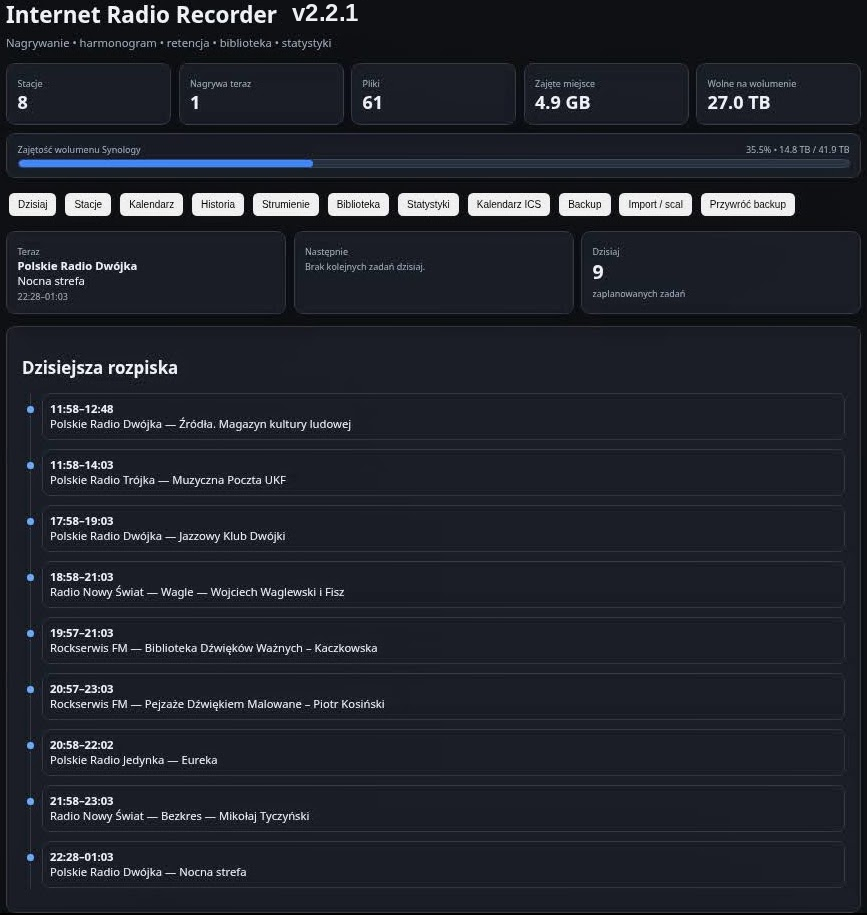
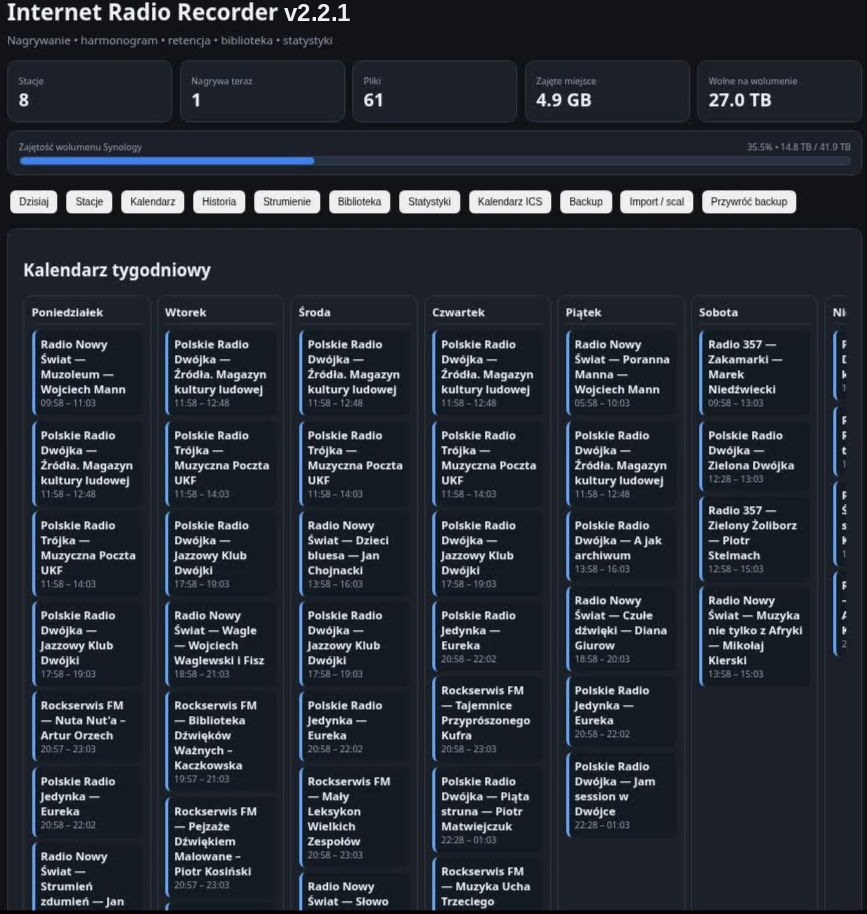
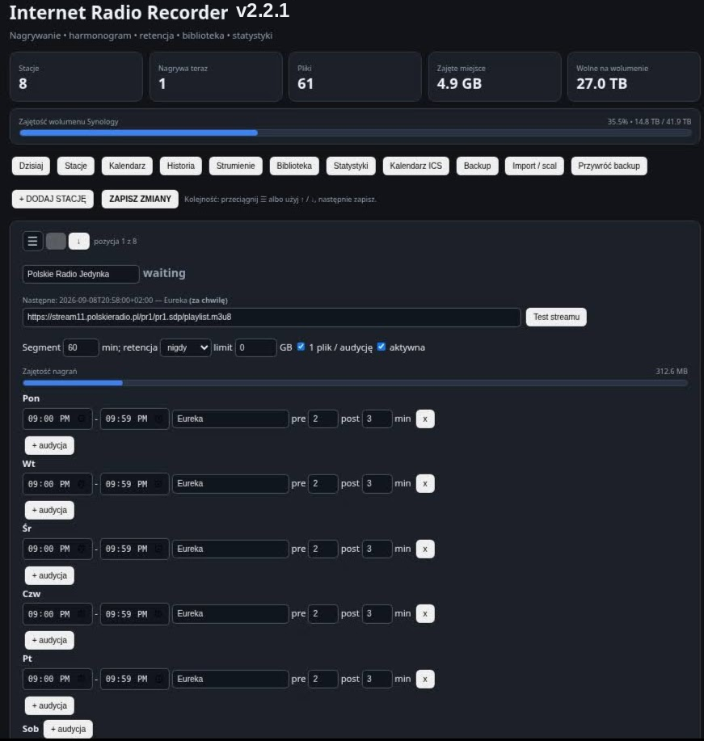
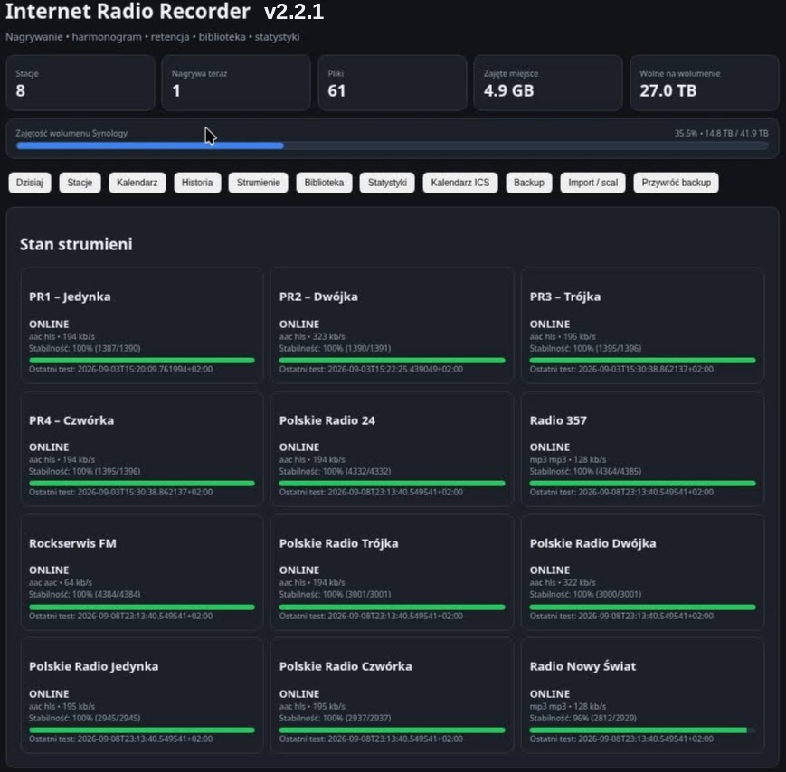
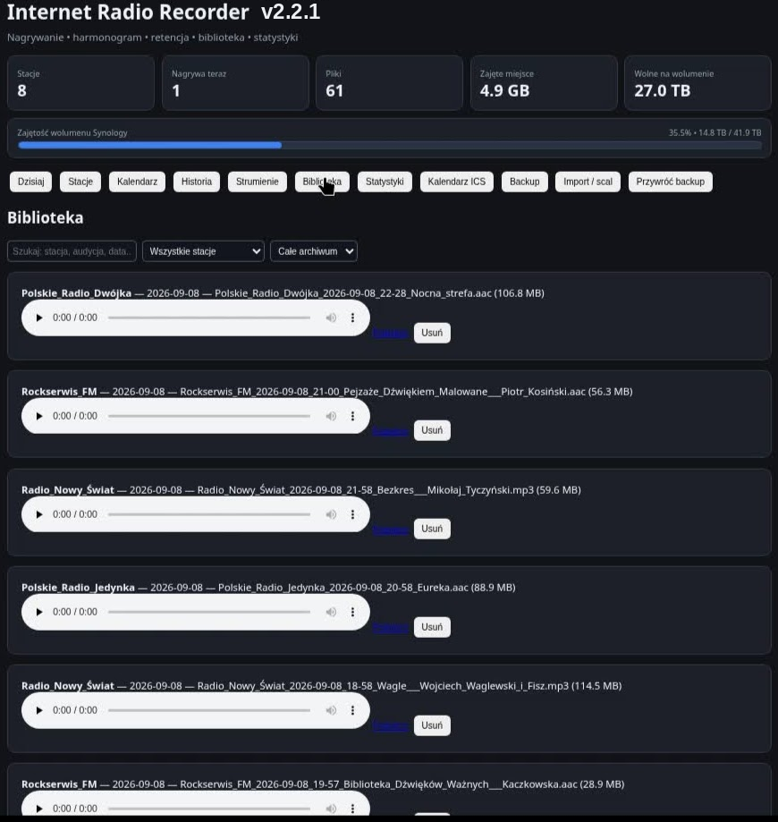
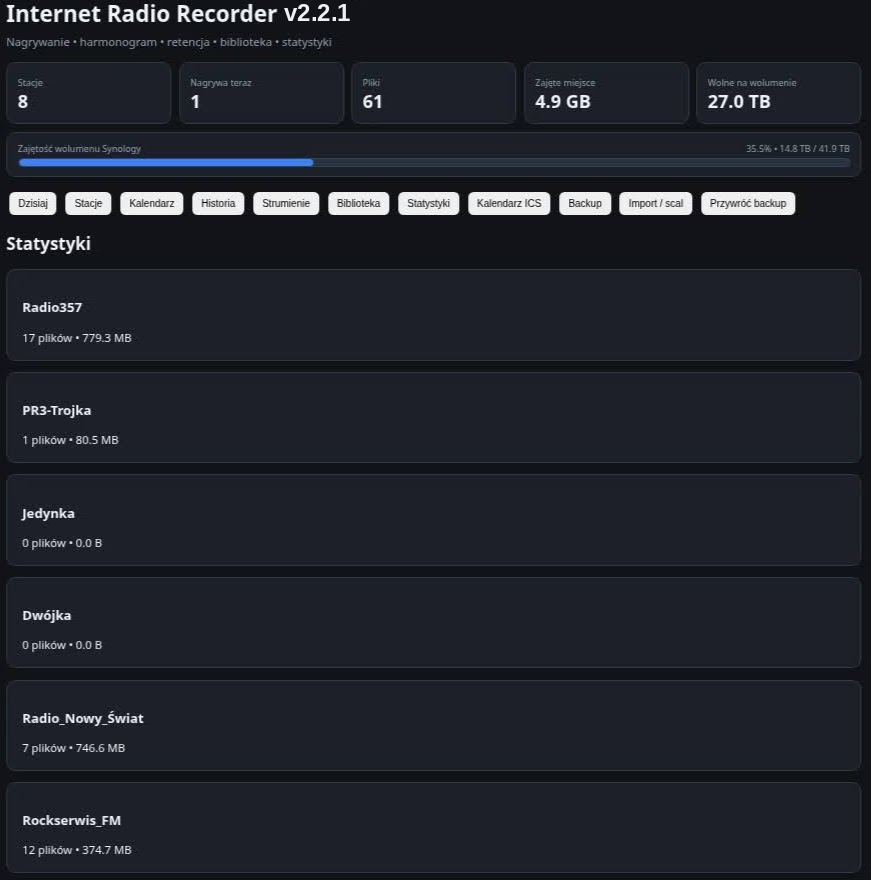

# Internet Radio Recorder

Self-hosted Internet radio recorder with a web interface, weekly schedules, stream monitoring, recording library, ICS calendar support, configuration backup/merge, and Docker/Synology deployment.

Internet Radio Recorder was created as a simple way to record selected Internet radio programmes automatically on a NAS or home server without maintaining cron jobs or running a full broadcast automation stack.

Current release: **v2.2.2**

## Features

* multiple Internet radio stations,
* weekly recording schedules,
* programme titles,
* configurable `pre` / `post` recording margins,
* one file per programme,
* correct handling of adjacent programmes,
* support for programmes crossing midnight,
* recording without re-encoding using `ffmpeg -c:a copy`,
* manual `REC` / `STOP`,
* per-station retention limits,
* per-station storage limits,
* Today view,
* Calendar view,
* History,
* Stream monitoring,
* Recording Library,
* Statistics,
* stream availability testing,
* codec and bitrate diagnostics,
* optional NTFY notifications,
* optional webhook notifications,
* optional notifications after successful recordings,
* automatic MP3/AAC output selection when recording starts,
* detection of empty or missing recording files,
* ICS calendar subscription,
* configuration backup,
* safe configuration import / merge,
* station reordering using drag-and-drop or `↑` / `↓`,
* Docker Compose deployment,
* Synology / Portainer configuration example.

<!-- SCREENSHOTS_START -->

## Screenshots

The images below are historical captures with their displayed version label updated to
`v2.2.1`; they illustrate the interface and earlier example data rather than a
fresh capture of the running production server.

### Today — Scheduled Recordings



### Calendar



### Stations



### Stream Status



### Recording Library



### Statistics



<!-- SCREENSHOTS_END -->

## Quick Start

Requirements:

* Docker
* Docker Compose v2

Clone the repository:

```bash
git clone https://github.com/sp7uto/internet-radio-recorder.git
cd internet-radio-recorder
```

Create your local configuration:

```bash
cp .env.example .env
cp config/stations.example.json config/stations.json
```

Edit `.env` and at minimum change:

```text
CALENDAR_TOKEN
```

Then start the application:

```bash
docker compose up -d --build
```

The web interface is available by default at:

```text
http://server-address:8080
```

Recordings are stored in:

```text
./recordings
```

Application configuration is stored in:

```text
./config
```

## Synology / Portainer

A separate example configuration is included:

```text
docker-compose-portainer.yml
```

Example Synology paths:

```text
/volume1/docker/internet-radio-recorder/config
/volume1/docker/radio
```

See:

```text
docs/INSTALLATION.md
```

for detailed installation and upgrade instructions.

## Scheduling

Each station can contain multiple schedule entries for every day of the week.

Example:

```json
{
  "start": "20:00",
  "end": "21:00",
  "title": "Programme Name",
  "pre": 2,
  "post": 3
}
```

`pre` and `post` specify recording margins in minutes before and after the scheduled programme.

Programmes crossing midnight are supported.

When **one file per programme** is enabled, the nominal start of the next scheduled programme takes priority over overlapping recording margins.

More information:

```text
docs/SCHEDULING.md
```

## Backup and Import

The web interface provides several configuration management options.

**Backup**

Downloads the current `stations.json`.

**Import / Merge**

Keeps existing stations and schedules while adding new, non-conflicting entries.

**Restore Backup**

Replaces the complete configuration.

Before an import operation, Internet Radio Recorder automatically creates a timestamped backup:

```text
stations.before-import-YYYYMMDD-HHMMSS.json
```

More information:

```text
docs/BACKUP_AND_MERGE.md
```

## ICS Calendar

The recording schedule can be subscribed to as an ICS calendar.

Example:

```text
http://server-address:8080/calendar.ics?token=YOUR_TOKEN
```

The access token is configured using:

```text
CALENDAR_TOKEN
```

## Notifications

Optional notifications can be sent using:

* NTFY,
* webhook endpoints.

Set `NOTIFY_ON_COMPLETE=true` to send a notification after each successful
recording. Empty or missing output files always generate an error notification
when NTFY or a webhook is configured.

These can be used to report recording events and application status.

## Security

The web administration panel **does not provide built-in authentication**.

Anyone with access to the web interface may be able to:

* modify station configuration,
* start or stop recordings,
* delete recordings from the library.

Do **not** expose port `8080` directly to the public Internet.

Recommended remote access methods:

* Tailscale,
* VPN,
* reverse proxy with HTTPS and authentication.

See:

```text
SECURITY.md
```

## Documentation

* [Installation and upgrades](docs/INSTALLATION.md)
* [Configuration](docs/CONFIGURATION.md)
* [Scheduling](docs/SCHEDULING.md)
* [Backup and import/merge](docs/BACKUP_AND_MERGE.md)
* [API and endpoints](docs/API.md)
* [Troubleshooting](docs/TROUBLESHOOTING.md)
* [Automatic Docker updates (GHCR / VPS)](docs/AUTOMATIC_UPDATES.md)
* [Atomic maintenance gate (v2.2.2)](docs/ATOMIC_MAINTENANCE.md)
* [GitHub release and package publishing](docs/GITHUB_PUBLISHING.md)
* [Security](SECURITY.md)
* [Changelog](CHANGELOG.md)

## Technical Details

The Docker image is based on:

```text
debian:bookworm-slim
```

It includes:

* Python 3,
* FFmpeg,
* FFprobe.

The container runs as UID:

```text
1000
```

Mounted `/config` and `/recordings` directories must therefore be writable by that user.

## Latest Release

Current stable release: **v2.2.2**. This release adds an atomic maintenance gate coordinating recording workers and the VPS Docker updater; MP3/AAC correctness improvements from v2.2.1 remain included. See [v2.2.2 release notes](RELEASE_NOTES_v2.2.2.md).

**Automated Docker delivery:** stable images are published to the [public GHCR package](https://github.com/sp7uto/internet-radio-recorder/pkgs/container/internet-radio-recorder) as `ghcr.io/sp7uto/internet-radio-recorder:stable` and with versioned tags (current stable release: `v2.2.2`). The reference `irr-vps` completed its first guarded automatic Docker update of v2.2.1 on **2026-10-26 at 01:30 CET**. On **2026-10-26 at 03:01:21 CET**, its timer automatically deployed v2.2.2 with the atomic maintenance gate: the VPS update journal confirmed an exclusive maintenance lock, a successful container recreation and the running recorder confirmed `flock-v1`. The prior Docker image was retained for rollback. This VPS-specific automation is optional; a normal Docker Compose installation does not install the timer. See [Automatic updates](docs/AUTOMATIC_UPDATES.md) for status, safety limits, troubleshooting and rollback.

## Contributing

Bug reports, feature requests and pull requests are welcome.

Please see:

```text
CONTRIBUTING.md
```

## License

Internet Radio Recorder is released under the **MIT License**.

See:

```text
LICENSE
```

## Feedback

If you already record Internet radio or podcasts on a home server, feedback is especially welcome.

Ideas, bug reports and suggestions can be submitted through GitHub Issues.
