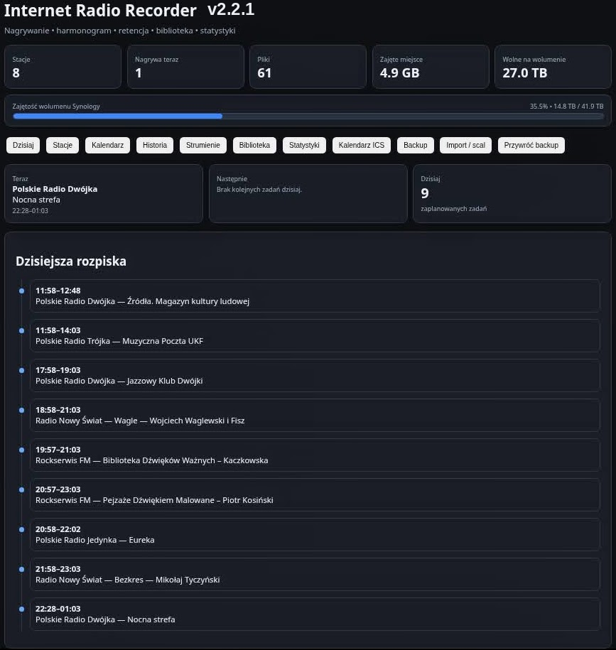

<p align="center"></p>

<p align="center"></p>

<h1 align="center">Internet Radio Recorder</h1>

<p align="center"><strong>Zaplanuj. Nagraj. Zachowaj.</strong><br>Internetowy rejestrator audycji radiowych na własny NAS lub serwer.</p>

<p align="center"><strong>🇵🇱 Polski</strong> · <a href="README.md">🇬🇧 English</a></p>

<p align="center">
<a href="https://github.com/sp7uto/internet-radio-recorder/actions/workflows/ci.yml"></a>
<a href="https://github.com/sp7uto/internet-radio-recorder/releases/latest"></a>
<a href="https://github.com/sp7uto/internet-radio-recorder/pkgs/container/internet-radio-recorder"></a>
<a href="LICENSE"></a>
</p>



*Historyczny zrzut demonstracyjny interfejsu, nie aktualny obraz wersji produkcyjnej.*

## Dlaczego IRR?

**Internet Radio Recorder** umożliwia nagrywanie audycji z internetowych stacji radiowych według tygodniowego harmonogramu. Wszystkim zarządzasz w przeglądarce. Pliki audio i ustawienia pozostają na Twoich dyskach. Program jest przeznaczony do samodzielnej instalacji na Linuxie, serwerze NAS albo VPS z Dockerem.

[**Najnowsze wydanie stabilne**](https://github.com/sp7uto/internet-radio-recorder/releases/latest) · [**Wiki po polsku**](https://github.com/sp7uto/internet-radio-recorder/wiki/Home-PL) · [**English Wiki**](https://github.com/sp7uto/internet-radio-recorder/wiki/Home)

## Możliwości

| Obszar | Funkcje |
| --- | --- |
| Nagrywanie | Wiele strumieni, FFprobe rozpoznający MP3/AAC, kopiowanie bez ponownego kodowania, ręczne REC/STOP |
| Harmonogram | Cykliczne audycje, marginesy `pre`/`post`, sąsiednie programy, przekroczenie północy |
| Panel WWW | Dzisiaj, Kalendarz, Historia, Stan strumieni, Biblioteka nagrań, Statystyki |
| Diagnostyka | Testy strumieni, kodek i bitrate, wykrywanie brakujących i pustych plików |
| Przechowywanie | Retencja i limity miejsca dla stacji, backup, import/scal i pełne przywracanie ustawień |
| Integracje | Subskrypcja ICS, opcjonalne powiadomienia NTFY/webhook |
| Instalacja | Docker Compose, wzorzec Synology/Portainer, obrazy GHCR |

## Szybki start

**Wymagane:** Docker i Docker Compose v2.

```bash
git clone https://github.com/sp7uto/internet-radio-recorder.git
cd internet-radio-recorder
cp .env.example .env
cp config/stations.example.json config/stations.json
```

W pliku `.env` koniecznie ustaw nowy, długi losowy `CALENDAR_TOKEN`. Po upewnieniu się, że katalogi trwałe są zapisywalne:

```bash
docker compose up -d --build
```

Wejdź na `http://adres-serwera:8080` **w zaufanej sieci lokalnej**.

| Katalog na hoście | Przeznaczenie |
| --- | --- |
| `./config` | Konfiguracja, stan i historia |
| `./recordings` | Pliki audio |

Proces w kontenerze działa jako UID `1000`; oba katalogi muszą być dla niego zapisywalne.

> [!WARNING]
> **Panel administracyjny nie ma wbudowanego logowania. Nigdy nie udostępniaj portu 8080 bezpośrednio w publicznym Internecie.** Do zdalnego dostępu użyj VPN albo reverse proxy z HTTPS i uwierzytelnianiem.

## Planowanie nagrań

Przykładowy wpis audycji:

```json
{
  "start": "20:00",
  "end": "21:00",
  "title": "Nazwa audycji",
  "pre": 2,
  "post": 3
}
```

`pre` i `post` wyrażają margines nagrania w minutach. Obsługiwane są również audycje przechodzące przez północ. W trybie **1 plik na audycję** nominalny start następnego programu ma pierwszeństwo przed nakładającymi się marginesami.

[Więcej o harmonogramie](https://github.com/sp7uto/internet-radio-recorder/wiki/Scheduling-PL)

## Zabezpieczenie ustawień

| Operacja w panelu | Znaczenie |
| --- | --- |
| Backup | Pobiera bieżący `stations.json` |
| Import / scal | Dodaje niekolidujące ustawienia, zachowując istniejące |
| Przywróć backup | Zastępuje całą konfigurację |

Przed importem IRR zapisuje automatyczną kopię z datą i godziną.

## NAS, obrazy i aktualizacje

Repozytorium zawiera standardowy `docker-compose.yml` i przykładowy `docker-compose-portainer.yml`. Wzorzec Portainera należy dostosować do swoich katalogów i uprawnień. Dostępne są także publiczne obrazy [GHCR](https://github.com/sp7uto/internet-radio-recorder/pkgs/container/internet-radio-recorder).

Opcjonalny mechanizm automatycznych aktualizacji wdrożony na referencyjnym VPS sprawdza harmonogram i aktywność nagrywania; blokada `flock` koordynuje restart. **Timer VPS nie jest instalowany w zwykłym Docker Compose.**

## Kalendarz i powiadomienia

```text
http://adres-serwera:8080/calendar.ics?token=TWOJ_TOKEN
```

ICS korzysta z `CALENDAR_TOKEN`, który chroni jedynie kalendarz, a nie administrację. NTFY i webhooki umożliwiają wysyłanie komunikatów, w tym o ukończonych nagraniach przy `NOTIFY_ON_COMPLETE=true`.

## Dokumentacja

| Polski | English |
| --- | --- |
| [Wiki — strona główna](https://github.com/sp7uto/internet-radio-recorder/wiki/Home-PL) | [Wiki — Home](https://github.com/sp7uto/internet-radio-recorder/wiki/Home) |
| [Instalacja](docs/INSTALLATION.md) | [Installation](docs/en/INSTALLATION.md) |
| [Konfiguracja](docs/CONFIGURATION.md) | [Configuration](docs/en/CONFIGURATION.md) |
| [Harmonogram](docs/SCHEDULING.md) | [Scheduling](docs/en/SCHEDULING.md) |
| [API](docs/API.md) | [API](docs/en/API.md) |
| [Kopie i import](docs/BACKUP_AND_MERGE.md) | [Backup and import](docs/en/BACKUP_AND_MERGE.md) |
| [Diagnostyka](docs/TROUBLESHOOTING.md) | [Troubleshooting](docs/en/TROUBLESHOOTING.md) |
| [Bezpieczeństwo](SECURITY.md) | [Security](SECURITY.en.md) |

Pełne rozdziały Wiki są dostępne w obydwu językach, z bezpośrednimi przełącznikami na odpowiadające sobie strony.

## Rozwój i licencja

Propozycje zmian i zgłoszenia błędów: [GitHub Issues](https://github.com/sp7uto/internet-radio-recorder/issues). Projekt jest udostępniany na [licencji MIT](LICENSE).

---

<p align="center"></p>
