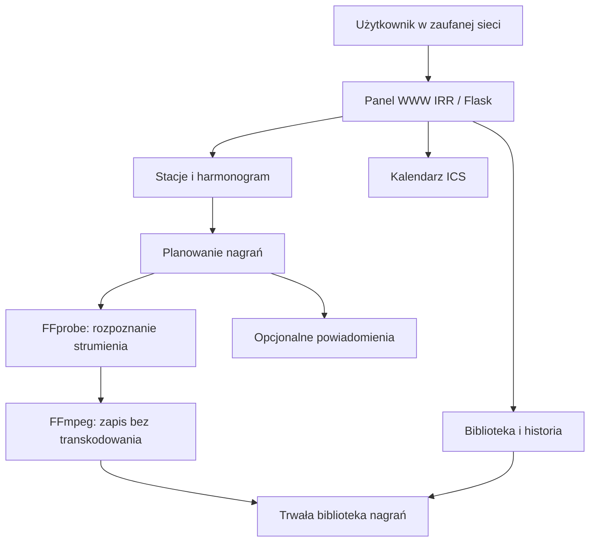

# Architektura

**🇵🇱 Polski** · [🇬🇧 English](https://github.com/sp7uto/internet-radio-recorder/wiki/Architecture)

IRR łączy panel WWW, konfigurację stacji, harmonogram i procesy nagrywające. Dane znajdują się poza kontenerem w trwałych katalogach.

## Przebieg nagrania

1. Użytkownik zapisuje adres audio stacji i plan audycji.
2. Harmonogram wyznacza czas rozpoczęcia i zakończenia.
3. FFprobe rozpoznaje właściwości strumienia; FFmpeg zapisuje obsługiwane MP3/AAC bez transkodowania.
4. Plik trafia do `/recordings`, a wynik wykonania do historii.
5. Opcjonalnie wysyłane są powiadomienia, także o braku lub pustym pliku.

## Ważne granice

Zwykły IRR nie wymaga osobnego systemu synchronizacji NAS, mechanizmu automatycznych aktualizacji VPS ani publicznego reverse proxy. Elementy te mogą być dodatkami specyficznymi dla instalacji.

**Bezpieczeństwo:** token ICS nie zabezpiecza panelu administracyjnego ani całego API.

[Konfiguracja](https://github.com/sp7uto/internet-radio-recorder/blob/main/docs/CONFIGURATION.md) · [API](https://github.com/sp7uto/internet-radio-recorder/blob/main/docs/API.md)
