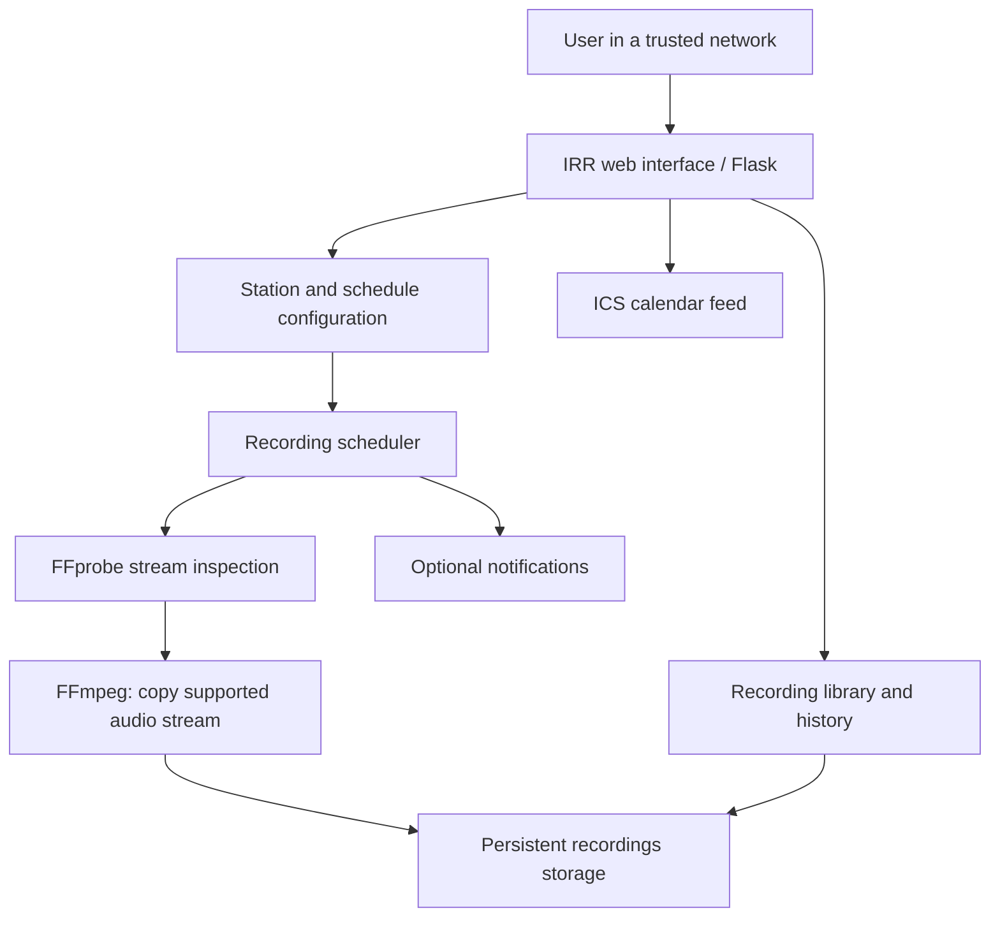

# Architecture

**[🇵🇱 Polski](https://github.com/sp7uto/internet-radio-recorder/wiki/Architecture-PL)** · 🇬🇧 English

**[🇵🇱 Polski](https://github.com/sp7uto/internet-radio-recorder/wiki/Architecture-PL)** · 🇬🇧 English

This page describes the product architecture, not the private network layout of any individual deployment.

## System overview

## Main building blocks

| Component | Responsibility |
| --- | --- |
| Web interface | Manage stations, schedules, recording commands and history |
| Station configuration | Describe the streams and the programmes to record |
| Scheduler | Determine when to start and stop recording jobs |
| FFprobe | Inspect an Internet stream and detect audio metadata |
| FFmpeg | Record stream audio without re-encoding when supported |
| Persistent storage | Hold configuration and recorded files outside the container |
| Notifications and ICS | Optional event messages and read-only calendar subscriptions |

## Typical recording lifecycle

1. An administrator configures an Internet radio station and its stream URL.
2. A programme is scheduled with a title and optional pre/post margins.
3. At the scheduled time, IRR inspects the source and starts the recording process.
4. The resulting audio is written to persistent storage and shown in the web interface.
5. IRR can identify a missing or empty output file; configured notification destinations can receive events.

Not every radio server guarantees uninterrupted broadcasting. A stream test verifies current connectivity, not future availability.

## Deployment boundaries

A normal installation consists of the application container and host-mounted configuration/recording directories. It does **not** need a QNAP-to-Synology copy chain, an external backup server, an automatic VPS update timer or a public reverse proxy to operate.

The optional reference VPS updater has its own safety mechanisms and documentation. See [Updates and Recovery](https://github.com/sp7uto/internet-radio-recorder/wiki/Updates-and-Recovery) and [Automatic Docker Updates](https://github.com/sp7uto/internet-radio-recorder/blob/main/docs/AUTOMATIC_UPDATES.md).

## Security boundary

The administration UI has no built-in login. Restrict network access to trusted clients or place it behind an authenticated HTTPS reverse proxy. The ICS subscription token protects the calendar URL but **is not an administration password**.

## Further reading

- [Getting Started](https://github.com/sp7uto/internet-radio-recorder/wiki/Getting-Started)
- [Scheduling](https://github.com/sp7uto/internet-radio-recorder/wiki/Scheduling)
- [Storage and Backups](https://github.com/sp7uto/internet-radio-recorder/wiki/Storage-and-Backups)
- [API reference](https://github.com/sp7uto/internet-radio-recorder/blob/main/docs/API.md)
- [Security](https://github.com/sp7uto/internet-radio-recorder/wiki/Security)
