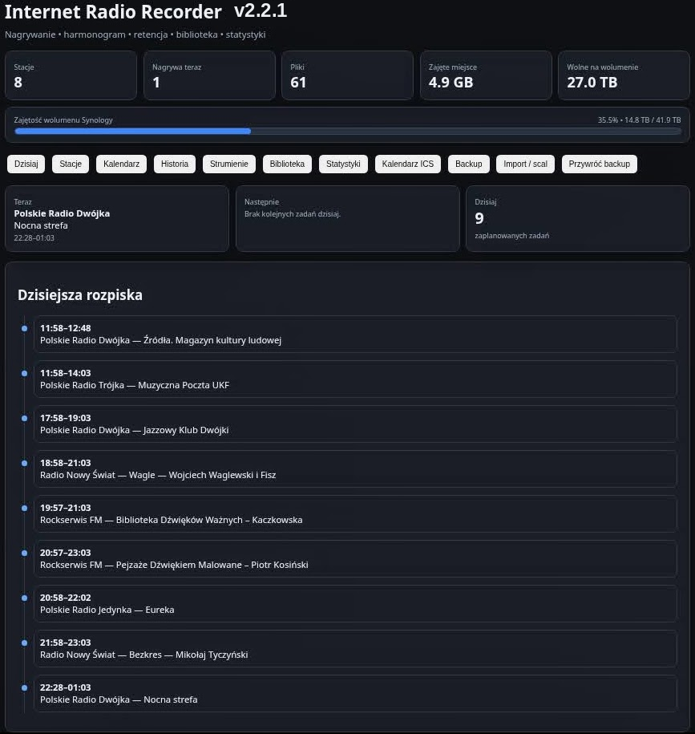

# Internet Radio Recorder — Dokumentacja

<p align="center"></p>
<p align="center"><strong>Zaplanuj. Nagraj. Zachowaj.</strong><br>Rejestrator internetowych stacji radiowych na własnym serwerze.</p>

**🇵🇱 Polski** · [🇬🇧 English](https://github.com/sp7uto/internet-radio-recorder/wiki/Home)

[](https://github.com/sp7uto/internet-radio-recorder/releases/latest) [](https://github.com/sp7uto/internet-radio-recorder/actions/workflows/ci.yml)



*Zrzut demonstracyjny wcześniejszej wersji programu, a nie aktualny widok instalacji.*

## Witaj w dokumentacji

**Internet Radio Recorder (IRR)** nagrywa audycje z internetowych strumieni radiowych według ustalonego harmonogramu. Pracuje w Dockerze, m.in. na serwerach Linux, VPS i zgodnych serwerach NAS. Nagrania pozostają na Twoim nośniku.

## Spis treści

| Zagadnienie | Poradnik |
| --- | --- |
| Pierwsze uruchomienie | [Pierwsze kroki](https://github.com/sp7uto/internet-radio-recorder/wiki/Getting-Started-PL) |
| Budowa i zasada działania | [Architektura](https://github.com/sp7uto/internet-radio-recorder/wiki/Architecture-PL) |
| Stacje i rejestrowanie | [Stacje i nagrywanie](https://github.com/sp7uto/internet-radio-recorder/wiki/Stations-and-Recording-PL) |
| Planowanie audycji | [Harmonogram](https://github.com/sp7uto/internet-radio-recorder/wiki/Scheduling-PL) |
| Retencja, pliki i kopie | [Pamięć i kopie zapasowe](https://github.com/sp7uto/internet-radio-recorder/wiki/Storage-and-Backups-PL) |
| Serwery i kontenery | [Docker i NAS](https://github.com/sp7uto/internet-radio-recorder/wiki/Docker-and-NAS-PL) |
| Kalendarz i powiadomienia | [Integracje](https://github.com/sp7uto/internet-radio-recorder/wiki/Integrations-PL) |
| Aktualizacje i cofanie zmian | [Aktualizacje i odzyskiwanie](https://github.com/sp7uto/internet-radio-recorder/wiki/Updates-and-Recovery-PL) |
| Rozpoznawanie usterek | [Rozwiązywanie problemów](https://github.com/sp7uto/internet-radio-recorder/wiki/Troubleshooting-PL) |
| Dostęp i ochrona | [Bezpieczeństwo](https://github.com/sp7uto/internet-radio-recorder/wiki/Security-PL) |
| Krótkie odpowiedzi | [Najczęstsze pytania](https://github.com/sp7uto/internet-radio-recorder/wiki/Frequently-Asked-Questions-PL) |

## Najważniejsze możliwości

| Obszar | Funkcje |
| --- | --- |
| Nagrywanie | Wiele stacji, test strumieni, FFprobe, MP3/AAC, kopiowanie bez ponownej kompresji, REC/STOP |
| Harmonogram | Audycje cykliczne, osobne pliki, marginesy przed/po, przekroczenie północy |
| Panel WWW | Dzisiaj, Kalendarz, Stacje, Stan strumieni, Historia, Biblioteka, Statystyki |
| Dane | Katalogi trwałe, retencja według stacji, import/scalanie i przywracanie ustawień |
| Integracje | Subskrypcja ICS, NTFY i webhooki |
| Dystrybucja | Docker Compose, przykład Portainera, obrazy GHCR |

## Szybka instalacja

Na komputerze z Docker i Docker Compose v2:

```bash
git clone https://github.com/sp7uto/internet-radio-recorder.git
cd internet-radio-recorder
cp .env.example .env
cp config/stations.example.json config/stations.json
```

Ustaw silny losowy `CALENDAR_TOKEN` w `.env`, zapewnij prawa zapisu do katalogów trwałych i wykonaj:

```bash
docker compose up -d --build
```

Panel dostępny jest zwykle pod `http://adres-serwera:8080` — **wyłącznie w zaufanej sieci**.

> [!WARNING]
> **Panel administracyjny IRR nie ma wbudowanego logowania.** Nie udostępniaj portu 8080 bezpośrednio w Internecie. Zdalny dostęp realizuj przez VPN albo uwierzytelniający reverse proxy HTTPS.

## Zasoby projektu

[Kod źródłowy](https://github.com/sp7uto/internet-radio-recorder) · [Wydania](https://github.com/sp7uto/internet-radio-recorder/releases) · [Obrazy Docker](https://github.com/sp7uto/internet-radio-recorder/pkgs/container/internet-radio-recorder) · [Dokumentacja techniczna](https://github.com/sp7uto/internet-radio-recorder/tree/main/docs) · [Zgłoszenia](https://github.com/sp7uto/internet-radio-recorder/issues)

**Zakres:** Wiki jest podręcznikiem użytkownika; szczegółowe i zależne od wersji procedury zawiera katalog [docs/](https://github.com/sp7uto/internet-radio-recorder/tree/main/docs). Automatyczny aktualizator VPS jest rozwiązaniem opcjonalnym, a nie częścią standardowej instalacji Compose.
