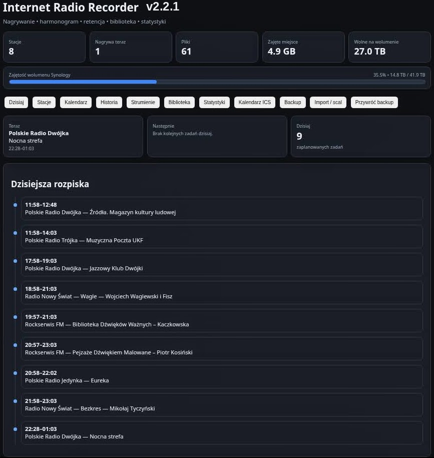
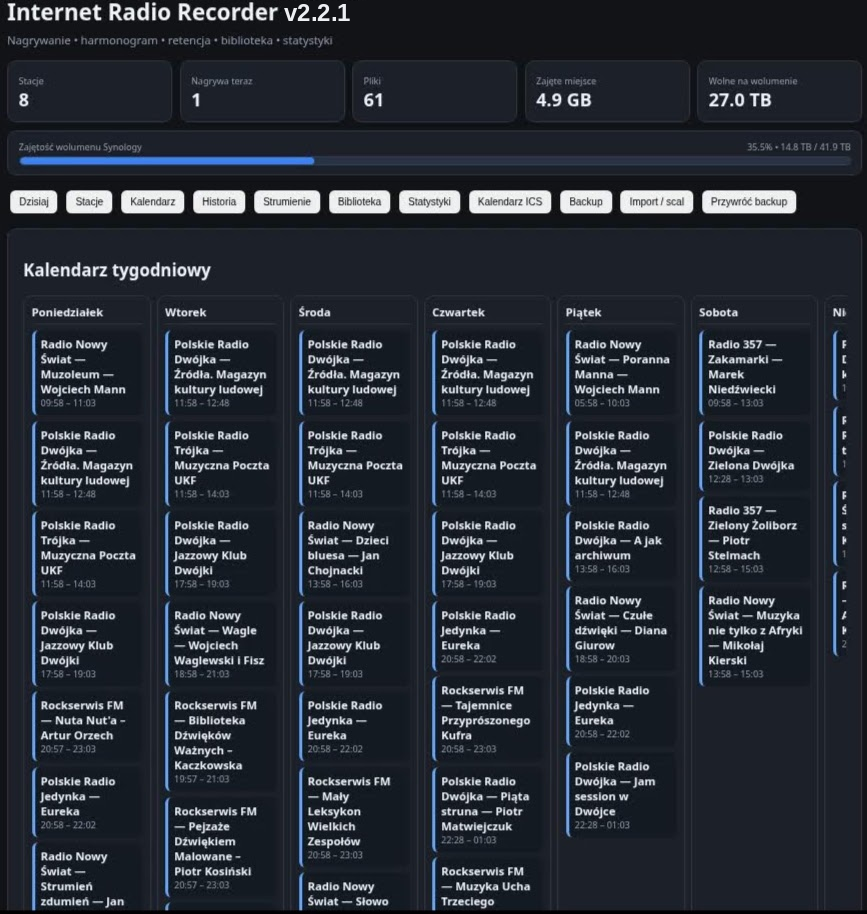
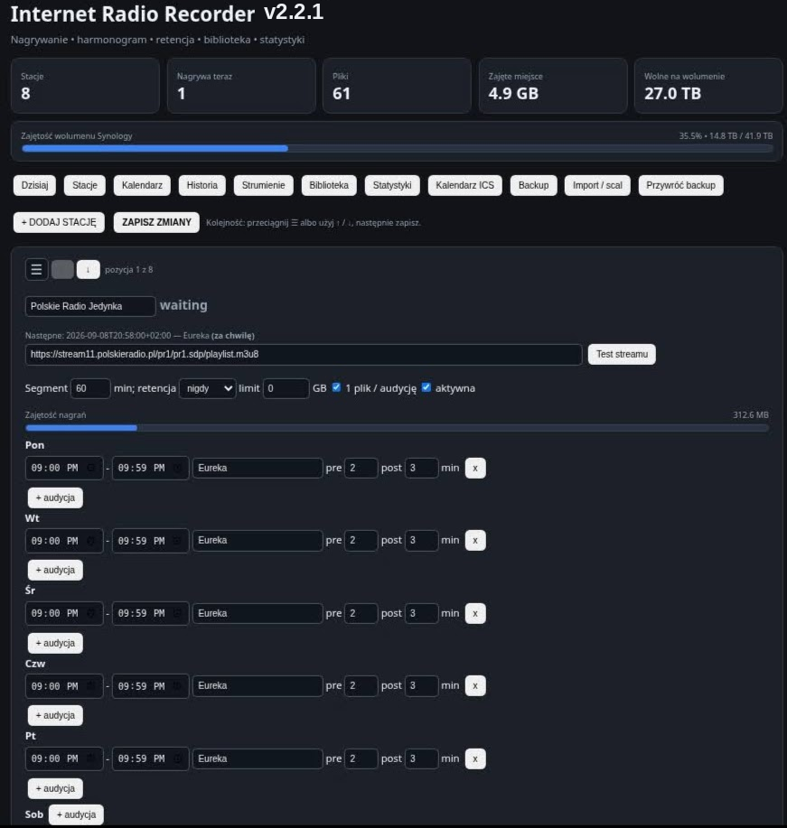
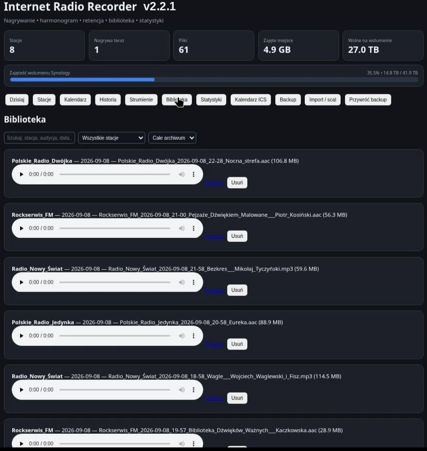

<p align="center"></p>

<h1 align="center">Internet Radio Recorder — Wiki</h1>
<p align="center"><a href="https://github.com/sp7uto/internet-radio-recorder/wiki/Home-PL">🇵🇱 Polski</a> · <strong>🇬🇧 English</strong></p>
<p align="center"><a href="https://github.com/sp7uto/internet-radio-recorder/wiki/Home-PL">🇵🇱 Polski</a> · <strong>🇬🇧 English</strong></p>
<p align="center"><strong>Schedule it. Record it. Keep it.</strong><br>A practical guide to self-hosted Internet radio recording.</p>

<p align="center">
<a href="https://github.com/sp7uto/internet-radio-recorder/releases/latest"></a>
<a href="https://github.com/sp7uto/internet-radio-recorder/actions/workflows/ci.yml"></a>
<a href="https://github.com/sp7uto/internet-radio-recorder/blob/main/LICENSE"></a>
</p>



*Illustrative historical screenshot, not a live view or a screenshot of the latest release.*

## Welcome

**Internet Radio Recorder (IRR)** helps you record radio programmes from Internet streams on a NAS, home server or VPS. Define stations and recurring schedules, then manage recordings from a browser. Audio is saved on your own storage.

## Find your way

| I want to… | Read |
| --- | --- |
| Install the application | [Getting Started](https://github.com/sp7uto/internet-radio-recorder/wiki/Getting-Started) |
| Understand the components and recording flow | [Architecture](https://github.com/sp7uto/internet-radio-recorder/wiki/Architecture) |
| Add or test a radio stream, or start a manual recording | [Stations and Recording](https://github.com/sp7uto/internet-radio-recorder/wiki/Stations-and-Recording) |
| Schedule programmes, including recordings across midnight | [Scheduling](https://github.com/sp7uto/internet-radio-recorder/wiki/Scheduling) |
| Organise recordings and back up station settings | [Storage and Backups](https://github.com/sp7uto/internet-radio-recorder/wiki/Storage-and-Backups) |
| Run the application on Docker, Synology or QNAP | [Docker and NAS](https://github.com/sp7uto/internet-radio-recorder/wiki/Docker-and-NAS) |
| Subscribe to a calendar or configure notifications | [Integrations](https://github.com/sp7uto/internet-radio-recorder/wiki/Integrations) |
| Update or roll back a deployment | [Updates and Recovery](https://github.com/sp7uto/internet-radio-recorder/wiki/Updates-and-Recovery) |
| Diagnose a failed or empty recording | [Troubleshooting](https://github.com/sp7uto/internet-radio-recorder/wiki/Troubleshooting) |
| Understand access-control requirements | [Security](https://github.com/sp7uto/internet-radio-recorder/wiki/Security) |
| Find short answers to common questions | [Frequently Asked Questions](https://github.com/sp7uto/internet-radio-recorder/wiki/Frequently-Asked-Questions) |

## What IRR provides

| Area | Capabilities |
| --- | --- |
| Recording | Multiple stations, MP3/AAC source detection, stream copy without transcoding, manual REC/STOP |
| Planning | Weekly schedules, programme titles, pre/post recording margins and midnight-crossing programmes |
| Web interface | Today, Calendar, Stations, Stream Status, History, Recording Library and Statistics |
| Reliability | Stream diagnostics and detection of missing or empty recording output |
| Storage | Per-station retention and storage limits; backup, merge and restore of station configuration |
| Integration | ICS calendar, optional NTFY and webhook notifications |
| Deployment | Docker Compose, NAS/Portainer example, versioned container images on GHCR |

## Quick start

On a Docker host:

```bash
git clone https://github.com/sp7uto/internet-radio-recorder.git
cd internet-radio-recorder
cp .env.example .env
cp config/stations.example.json config/stations.json
```

Set a strong `CALENDAR_TOKEN` in `.env`, check permissions for the persistent directories, then start:

```bash
docker compose up -d --build
```

Open `http://server-address:8080` **on a trusted network only**. Full details: [Getting Started](https://github.com/sp7uto/internet-radio-recorder/wiki/Getting-Started).

> [!WARNING]
> **IRR does not provide built-in login for its administration panel.** Never expose port 8080 directly to the public Internet. For remote use, prefer a VPN (for example Tailscale) or an HTTPS reverse proxy with authentication. See [Security](https://github.com/sp7uto/internet-radio-recorder/wiki/Security).

## Screenshots

| Today | Calendar |
| :---: | :---: |
| [](https://github.com/sp7uto/internet-radio-recorder/blob/main/docs/screenshots/IRR01.png) | [](https://github.com/sp7uto/internet-radio-recorder/blob/main/docs/screenshots/IRR03.png) |
| Stations | Recording library |
| [](https://github.com/sp7uto/internet-radio-recorder/blob/main/docs/screenshots/IRR02.png) | [](https://github.com/sp7uto/internet-radio-recorder/blob/main/docs/screenshots/IRR05.png) |

*All screenshots illustrate earlier versions and sample data.*

## Project resources

[Source code](https://github.com/sp7uto/internet-radio-recorder) · [Releases](https://github.com/sp7uto/internet-radio-recorder/releases) · [Container images](https://github.com/sp7uto/internet-radio-recorder/pkgs/container/internet-radio-recorder) · [Technical documentation](https://github.com/sp7uto/internet-radio-recorder/tree/main/docs) · [Report a problem](https://github.com/sp7uto/internet-radio-recorder/issues)

**Documentation scope:** Wiki pages are learning and navigation guides. The version-specific files under [`docs/`](https://github.com/sp7uto/internet-radio-recorder/tree/main/docs) and [`SECURITY.md`](https://github.com/sp7uto/internet-radio-recorder/blob/main/SECURITY.md) are the authoritative operational references. The automatic-update timer used on the project's reference VPS is optional and is **not** installed by ordinary Docker Compose deployments.

---
Internet Radio Recorder · Open-source software · MIT License
